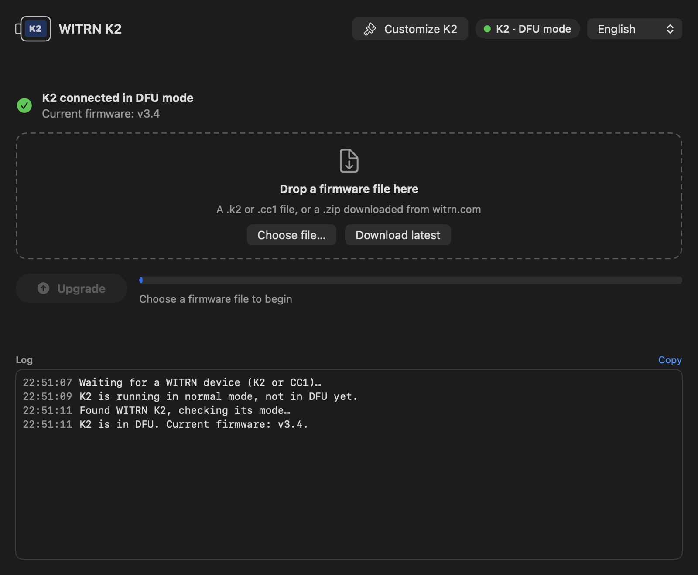
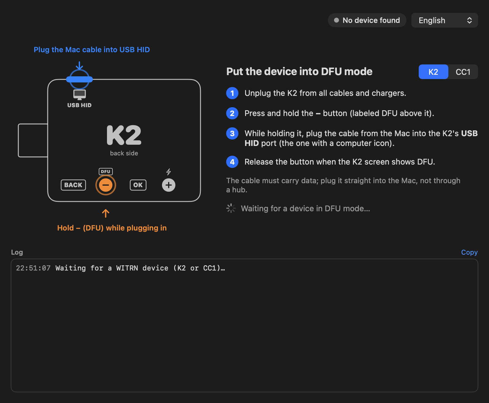
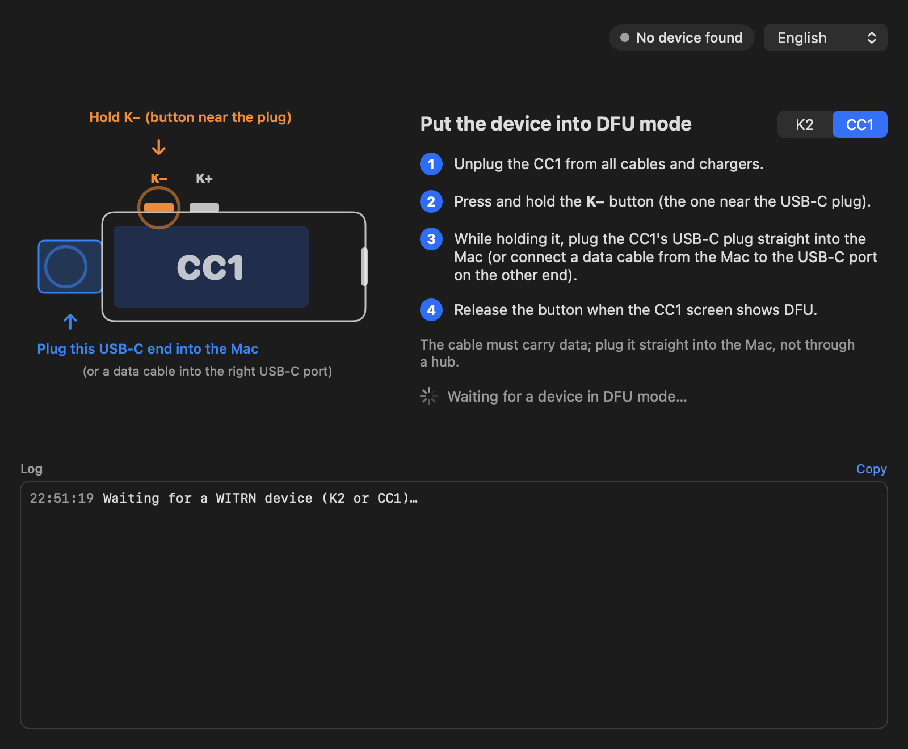
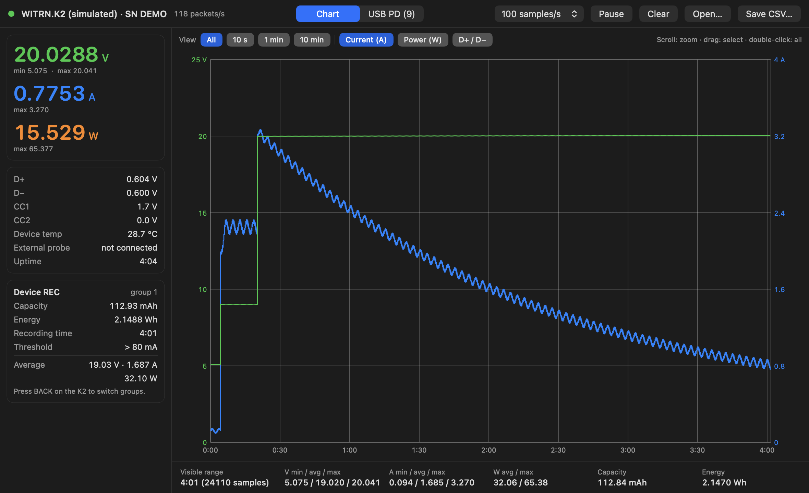
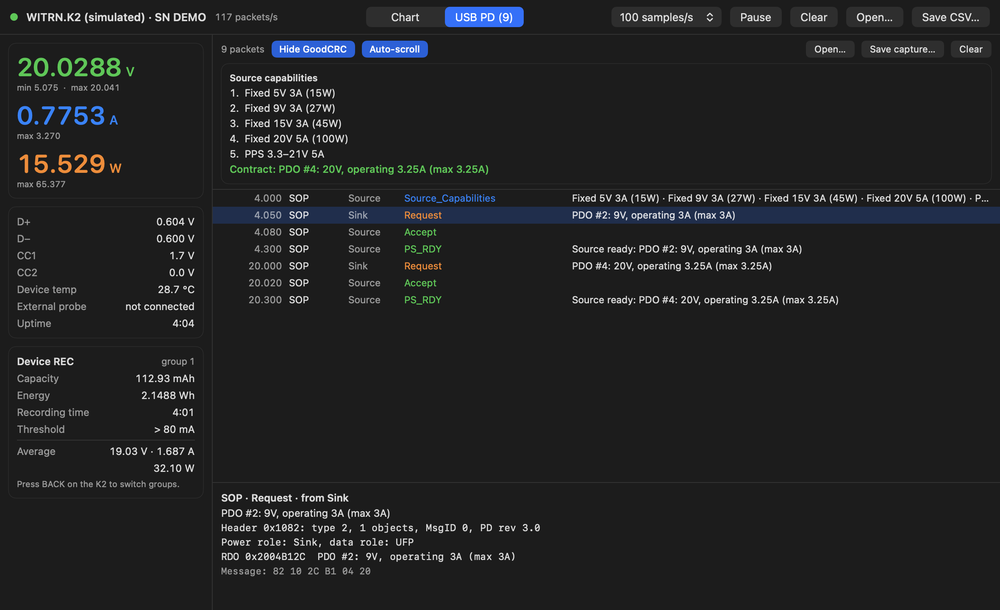
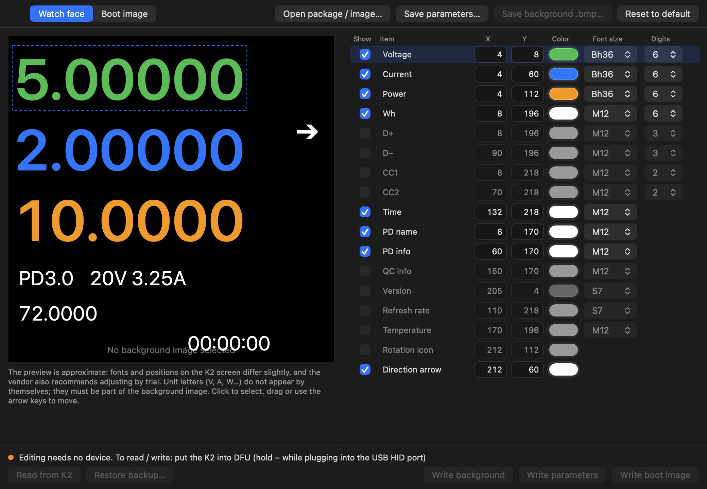

# Witrn USB Tester

**English** · [Tiếng Việt](README.vi.md)

A native macOS app for the **WITRN K2** and **WITRN CC1** USB testers: flash firmware, watch live voltage / current / power charts, decode USB Power Delivery packets, and customize the K2 watch face — no Windows machine needed.

> Unofficial community project. Not affiliated with or endorsed by WITRN. Flashing firmware and writing to your device is at your own risk.



## Features

| | K2 | CC1 |
|---|:-:|:-:|
| Flash firmware (DFU) | ✅ | ✅ |
| Download the latest firmware from witrn.com | ✅ | ✅ |
| Live monitor: V / A / W chart, REC data, D+ / D−, CC1 / CC2, temperature | ✅ | — |
| USB PD packet capture and decoding | ✅ | — |
| Customize watch face, background image and boot image | ✅ | — |

- **One window, auto-detect.** Plug the tester in and the app recognizes the model and its mode (normal or DFU).
- **English and Vietnamese UI**, switchable at any time from the main window or the **Language** menu. English is the default.
- **Universal binary** (Apple Silicon + Intel), macOS 11 Big Sur or later.
- **No dependencies.** A single Swift file talking USB HID through IOKit; no Python, no hidapi, no drivers.

## Screenshots

All screenshots below were taken with the app's built-in simulated device.

### Entering DFU mode

The app shows where the port and the button are for each model, and waits until the device appears.

| K2 | CC1 |
|---|---|
|  |  |

### Flashing firmware

Drop a `.k2` / `.cc1` file or the `.zip` from witrn.com, or click **Download latest**. Before anything is written the app checks the file's checksum, target model, load address and reset vector. After writing it reads everything back and compares byte by byte, and only then marks the firmware valid. The bootloader is never touched, so an interrupted flash can simply be repeated.


### Monitor (K2, read-only)

Live chart at up to 100 samples per second with zoom, range selection and statistics (min / avg / max, mAh, Wh). Save and reopen CSV files.



### USB PD decoding (K2)

Source capabilities, requests, the negotiated contract, EPR, VDMs and cable e-marker data, with the raw bytes of every message. Captures can be saved and reopened.



> The K2 only sends PD packets once the PD link to the computer (PD 联机) is enabled in the device settings; the vendor says firmware 4.6 or later is required.

### Customize K2

Edit the watch face layout (position, color, font and digits of each item), set a 240×240 background image and a 235×235 boot image from any picture. The app backs up the existing area to disk before every write and can restore it.



## Install

1. Download the latest `Witrn-USB-Tester-…-macos-universal.zip` from [Releases](../../releases/latest).
2. Unzip it and move **Witrn USB Tester.app** to **Applications**.
3. The app is not notarized by Apple, so macOS blocks the first launch. Either:
   - open **System Settings → Privacy & Security** and click **Open Anyway**, or
   - run this once in Terminal:
     ```sh
     xattr -dr com.apple.quarantine "/Applications/Witrn USB Tester.app"
     ```

## Usage

**Flash firmware**

1. Unplug the tester from every cable and charger.
2. Hold the DFU button (**−** on the K2, **K−** on the CC1) while plugging it into the Mac. Use the **USB HID** port on the K2.
3. Release the button when the device screen shows DFU.
4. Choose a firmware file (or **Download latest**) and click **Upgrade**. Do not unplug until it finishes.

**Monitor** — plug the K2 in normally (not DFU) through its USB HID port and click **Open Monitor**.

**Customize K2** — click **Customize K2** (shown when a K2 is connected) or use **File → Customize K2 Window**. Editing works without a device; reading from and writing to the K2 requires DFU mode.

Use a cable that carries data, plugged straight into the Mac rather than through a hub.

## Build from source

Requires the Xcode Command Line Tools (`xcode-select --install`).

```sh
./build.sh            # build and install into /Applications
./build.sh run        # launch the app
./build.sh test       # self-tests (no device needed)
./build.sh uninstall
```

Useful launch flags for trying the UI without hardware:

```sh
BIN="/Applications/Witrn USB Tester.app/Contents/MacOS/WitrnUSBTester"
"$BIN" --demo --model K2      # simulated K2 in DFU mode, nothing is written to real hardware
"$BIN" --monitor-demo         # monitor window with simulated data
```

### Releases

[`.github/workflows/build.yml`](.github/workflows/build.yml) builds the universal app and runs the self-tests on every push. Pushing a tag such as `v1.2.0` also zips the app and attaches it to a GitHub Release:

```sh
git tag v1.2.0 && git push origin v1.2.0
```

## Sources and credits

This app would not exist without the following work:

- **[lliooly/WITRN-K2-REVERSE](https://github.com/lliooly/WITRN-K2-REVERSE)** (MIT License) — reverse-engineering documentation of the WITRN K2: the USB HID / DFU protocol, firmware file format, telemetry packets, and the watch face / background / boot image formats and flash addresses. The protocol and file-format code here is an independent Swift implementation based on that documentation.
- **WITRN UP V3.0** (WITRN's official updater) — the per-model device table: USB product IDs, flash addresses and sector sizes for the K2 and CC1.
- **WITRN K2Picture 1.1** (WITRN's official watch face tool) — resource formats and addresses, as documented by the static analysis in WITRN-K2-REVERSE, cross-checked against the watch face packages WITRN publishes (`.k2pic` 400 bytes + `.bmp` 240×240).
- **[witrn.com](https://www.witrn.com)** — official firmware. **Download latest** fetches it directly from WITRN's pages ([K2](https://www.witrn.com/?p=2105), [CC1](https://www.witrn.com/?p=90)); no firmware is included in this repository.
- **USB Power Delivery Specification** (USB-IF) — message names and field layouts used by the PD decoder.
- Apple frameworks: SwiftUI, AppKit, IOKit (HID), Compression.

WITRN, K2 and CC1 are names of their respective owner and are used here only to describe compatibility.

## License

[MIT](LICENSE) — free to use, modify and share. The license file also carries the MIT notice of WITRN-K2-REVERSE. WITRN's firmware and official tools are not part of this repository and remain under WITRN's own terms.
