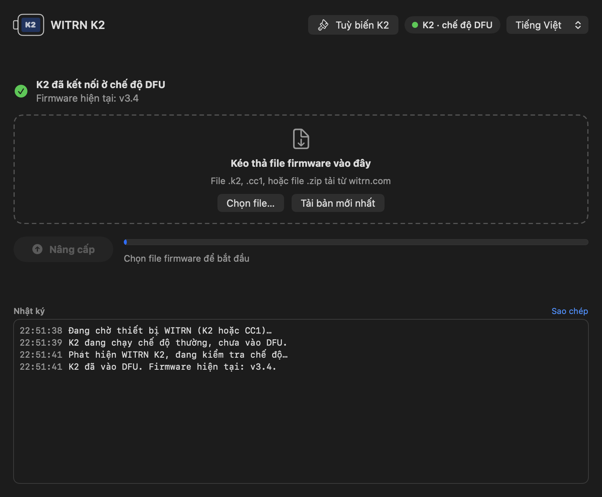
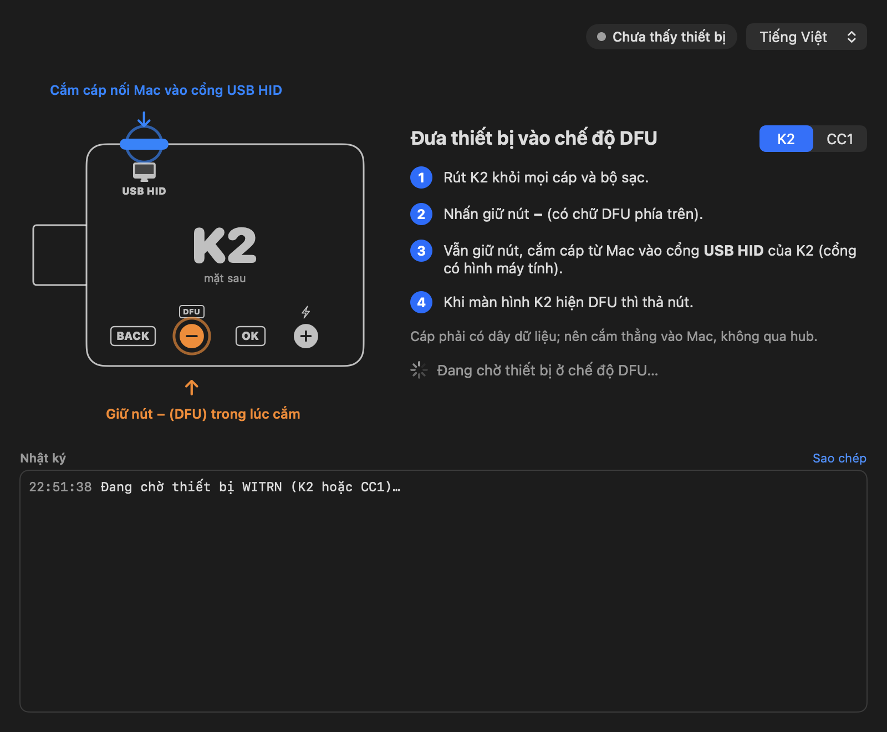
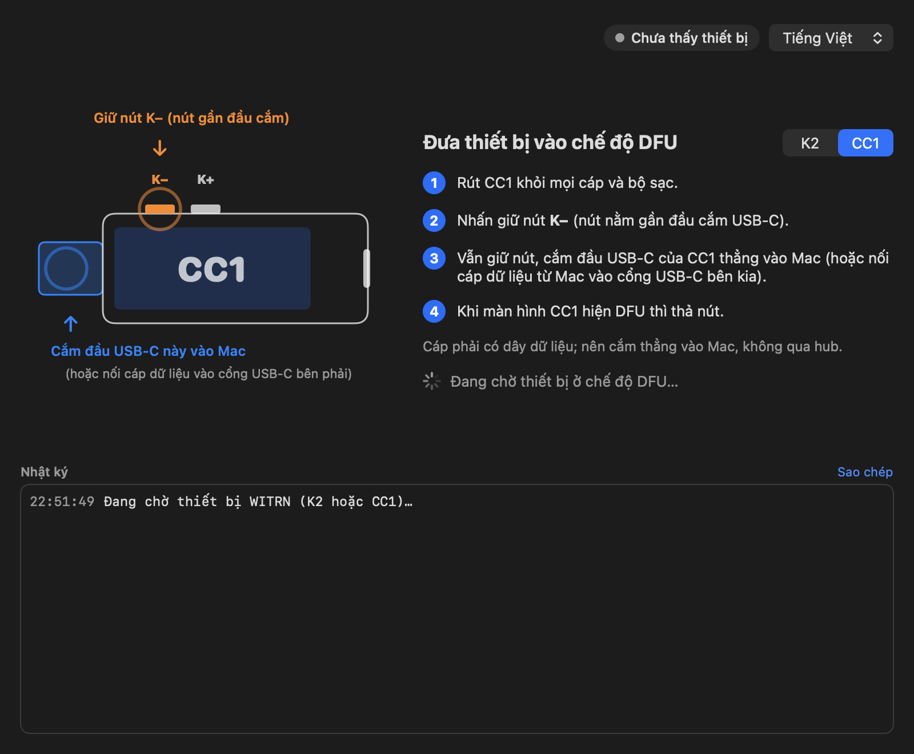
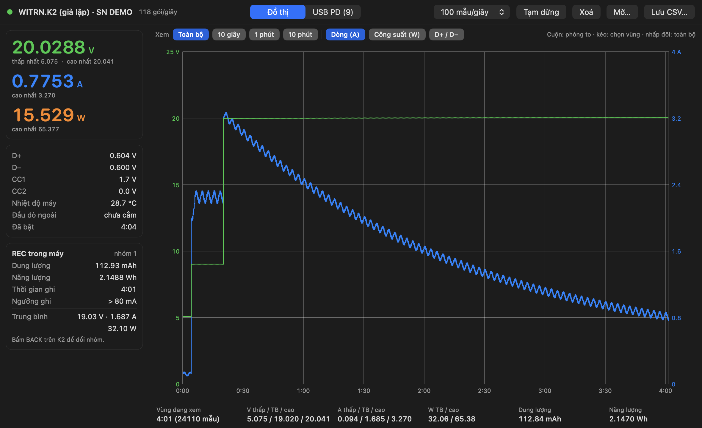
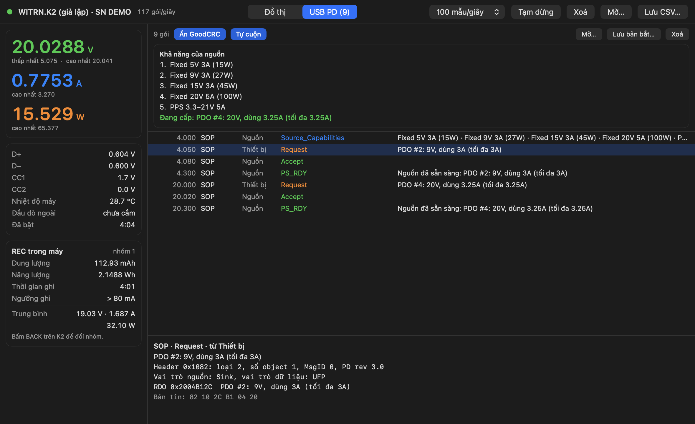
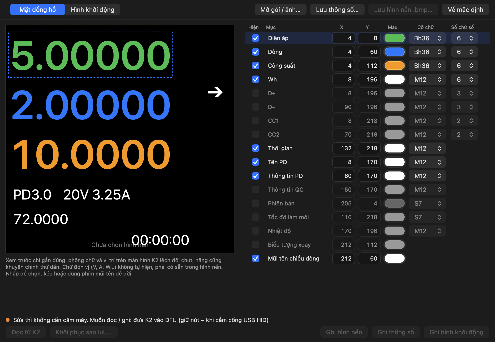

# Witrn USB Tester

[English](README.md) · **Tiếng Việt**

App macOS cho hai máy đo USB **WITRN K2** và **WITRN CC1**: nạp firmware, xem đồ thị điện áp / dòng / công suất trực tiếp, giải mã gói USB Power Delivery và tuỳ biến mặt đồng hồ của K2 — không cần máy Windows.

> Đây là dự án cộng đồng, không chính thức, không liên quan tới WITRN. Bạn tự chịu rủi ro khi nạp firmware và ghi vào thiết bị.



## Tính năng

| | K2 | CC1 |
|---|:-:|:-:|
| Nạp firmware (DFU) | ✅ | ✅ |
| Tải firmware mới nhất từ witrn.com | ✅ | ✅ |
| Monitor trực tiếp: đồ thị V / A / W, bản REC, D+ / D−, CC1 / CC2, nhiệt độ | ✅ | — |
| Bắt và giải mã gói USB PD | ✅ | — |
| Tuỳ biến mặt đồng hồ, hình nền, hình khởi động | ✅ | — |

- **Một cửa sổ, tự nhận diện.** Cắm máy vào là app nhận ra model và chế độ (thường hoặc DFU).
- **Giao diện tiếng Anh và tiếng Việt**, đổi bất cứ lúc nào ở cửa sổ chính hoặc menu **Language**. Mặc định là tiếng Anh.
- **Universal binary** (Apple Silicon + Intel), chạy từ macOS 11 Big Sur.
- **Không phụ thuộc gì thêm.** Một file Swift duy nhất, nói chuyện USB HID qua IOKit; không cần Python, hidapi hay driver.

## Hình ảnh

Các ảnh dưới đây chụp với thiết bị giả lập có sẵn trong app.

### Vào chế độ DFU

App chỉ rõ cổng cắm và nút bấm của từng model, rồi chờ tới khi thấy thiết bị.

| K2 | CC1 |
|---|---|
|  |  |

### Nạp firmware

Kéo thả file `.k2` / `.cc1` hoặc file `.zip` tải từ witrn.com, hoặc bấm **Tải bản mới nhất**. Trước khi ghi, app kiểm tra checksum, model đích, địa chỉ nạp và reset vector của file. Ghi xong app đọc lại toàn bộ và so từng byte, khớp rồi mới đánh dấu firmware hợp lệ. Bootloader không bao giờ bị đụng tới, nên nạp dở giữa chừng chỉ cần nạp lại.


### Monitor (K2, chỉ đọc)

Đồ thị trực tiếp tới 100 mẫu mỗi giây, có phóng to, chọn vùng và thống kê (thấp nhất / trung bình / cao nhất, mAh, Wh). Lưu và mở lại file CSV.



### Giải mã USB PD (K2)

Khả năng của nguồn, yêu cầu, hợp đồng đang cấp, EPR, VDM và thông tin e-marker của cáp, kèm byte thô của từng bản tin. Bản bắt có thể lưu và mở lại.



> K2 chỉ gửi gói PD khi đã bật mục kết nối PD với máy tính (PD 联机) trong cài đặt của máy; hãng ghi cần firmware 4.6 trở lên.

### Tuỳ biến K2

Sửa bố cục mặt đồng hồ (vị trí, màu, cỡ chữ, số chữ số của từng mục), đặt hình nền 240×240 và hình khởi động 235×235 từ ảnh bất kỳ. Trước mỗi lần ghi, app sao lưu vùng đang có ra ổ đĩa và có thể khôi phục lại.



## Cài đặt

1. Tải file `Witrn-USB-Tester-…-macos-universal.zip` mới nhất ở [Releases](../../releases/latest).
2. Giải nén rồi kéo **Witrn USB Tester.app** vào **Applications**.
3. App chưa được Apple notarize nên macOS sẽ chặn lần mở đầu tiên. Chọn một trong hai cách:
   - mở **System Settings → Privacy & Security** rồi bấm **Open Anyway**, hoặc
   - chạy lệnh này một lần trong Terminal:
     ```sh
     xattr -dr com.apple.quarantine "/Applications/Witrn USB Tester.app"
     ```

## Cách dùng

**Nạp firmware**

1. Rút máy khỏi mọi cáp và bộ sạc.
2. Giữ nút DFU (**−** trên K2, **K−** trên CC1) trong lúc cắm vào Mac. Với K2, cắm vào cổng **USB HID**.
3. Khi màn hình máy hiện DFU thì thả nút.
4. Chọn file firmware (hoặc **Tải bản mới nhất**) rồi bấm **Nâng cấp**. Không rút cáp cho tới khi xong.

**Monitor** — cắm K2 ở chế độ thường (không phải DFU) qua cổng USB HID rồi bấm **Mở Monitor**.

**Tuỳ biến K2** — bấm **Tuỳ biến K2** (hiện khi đã cắm K2) hoặc vào **Tệp → Cửa sổ Tuỳ biến K2**. Sửa thì không cần cắm máy; đọc và ghi vào K2 thì máy phải ở DFU.

Dùng cáp có dây dữ liệu và cắm thẳng vào Mac, không qua hub.

## Tự build từ mã nguồn

Cần Xcode Command Line Tools (`xcode-select --install`).

```sh
./build.sh            # build và cài vào /Applications
./build.sh run        # mở app
./build.sh test       # tự kiểm tra (không cần thiết bị)
./build.sh uninstall
```

Vài tham số để xem thử giao diện khi không có máy:

```sh
BIN="/Applications/Witrn USB Tester.app/Contents/MacOS/WitrnUSBTester"
"$BIN" --demo --model K2      # K2 giả lập ở chế độ DFU, không ghi gì vào thiết bị thật
"$BIN" --monitor-demo         # cửa sổ Monitor với dữ liệu giả lập
```

### Phát hành

[`.github/workflows/build.yml`](.github/workflows/build.yml) build app universal và chạy tự kiểm tra mỗi lần push. Khi push một tag dạng `v1.2.0`, workflow còn nén app và đính vào GitHub Release:

```sh
git tag v1.2.0 && git push origin v1.2.0
```

## Nguồn tham khảo và ghi công

App này dựa trên các nguồn sau:

- **[lliooly/WITRN-K2-REVERSE](https://github.com/lliooly/WITRN-K2-REVERSE)** (giấy phép MIT) — tài liệu dịch ngược WITRN K2: giao thức USB HID / DFU, định dạng file firmware, gói số đo, định dạng và địa chỉ flash của mặt đồng hồ / hình nền / hình khởi động. Phần giao thức và định dạng file ở đây được viết lại độc lập bằng Swift dựa theo tài liệu đó.
- **WITRN UP V3.0** (công cụ nâng cấp chính hãng của WITRN) — bảng thiết bị theo từng model: USB product ID, địa chỉ flash, kích thước sector của K2 và CC1.
- **WITRN K2Picture 1.1** (công cụ mặt đồng hồ chính hãng của WITRN) — định dạng và địa chỉ tài nguyên, theo phần phân tích tĩnh trong WITRN-K2-REVERSE, đã đối chiếu với các gói mặt đồng hồ hãng phát hành (`.k2pic` 400 byte + `.bmp` 240×240).
- **[witrn.com](https://www.witrn.com)** — firmware chính hãng. Nút **Tải bản mới nhất** lấy trực tiếp từ trang của WITRN ([K2](https://www.witrn.com/?p=2105), [CC1](https://www.witrn.com/?p=90)); repo này không chứa file firmware nào.
- **USB Power Delivery Specification** (USB-IF) — tên bản tin và bố cục trường dùng trong bộ giải mã PD.
- Framework của Apple: SwiftUI, AppKit, IOKit (HID), Compression.

WITRN, K2 và CC1 là tên thuộc về chủ sở hữu tương ứng, ở đây chỉ dùng để nói về tính tương thích.

## Giấy phép

[MIT](LICENSE) — tự do dùng, sửa và chia sẻ. File giấy phép có kèm thông báo MIT của WITRN-K2-REVERSE. Firmware và công cụ chính hãng của WITRN không nằm trong repo này và vẫn theo điều khoản riêng của WITRN.
